# Porchlight

*Match the costume. Light the jack.*

It's Halloween night, and the whole neighborhood is out trick-or-treating. Every
house with a pumpkin in the yard has one costume it loves more than any other.
Read the sign, knock to narrow down the color, then find the kid who's wearing
it and bribe them with candy to swap outfits. Walk back up to the door in the
right costume and the pumpkin bursts into a glowing jack-o'-lantern for your
collection. Light all fifty and the whole town comes out to dance with you.

**[▶ Play Porchlight](https://porchlight.synapticnoise.com)** in your browser.
No install, works on desktop and on phones.

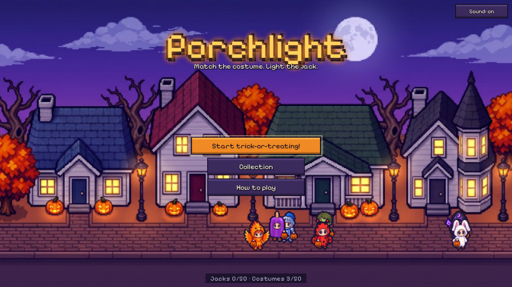

## The neighborhood

| | |
|---|---|
| 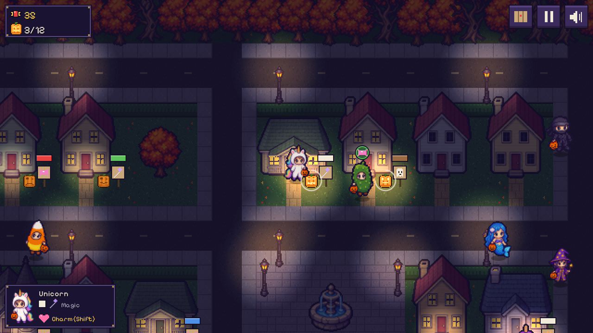 **Trick-or-treat.** Every night is a brand new town. Pumpkin signs show what each house loves, and every kid wears a badge with their costume's kind and color. | 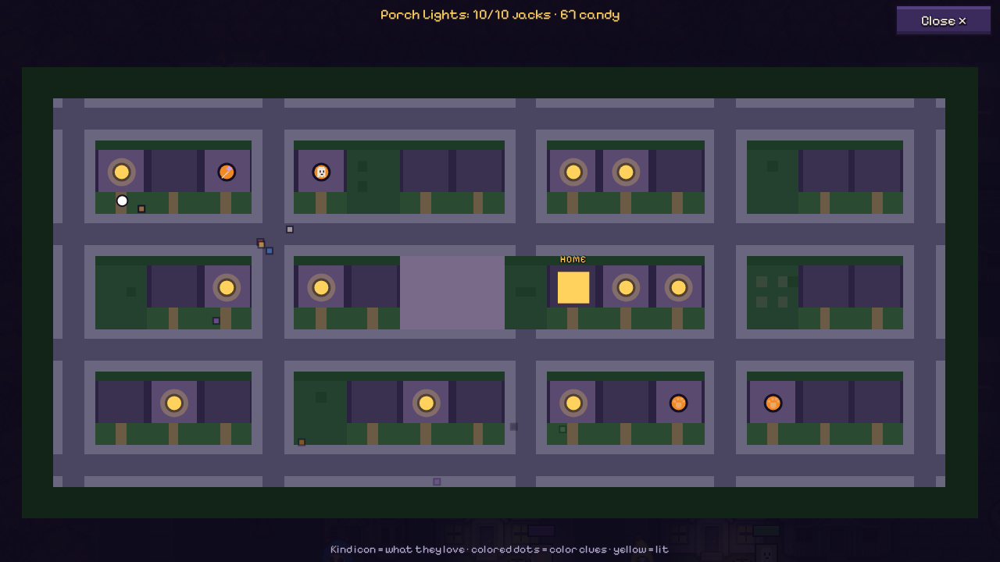 **The map.** Every pumpkin house, the clues you've found, and the kids you've spotted, all in one place. |
| 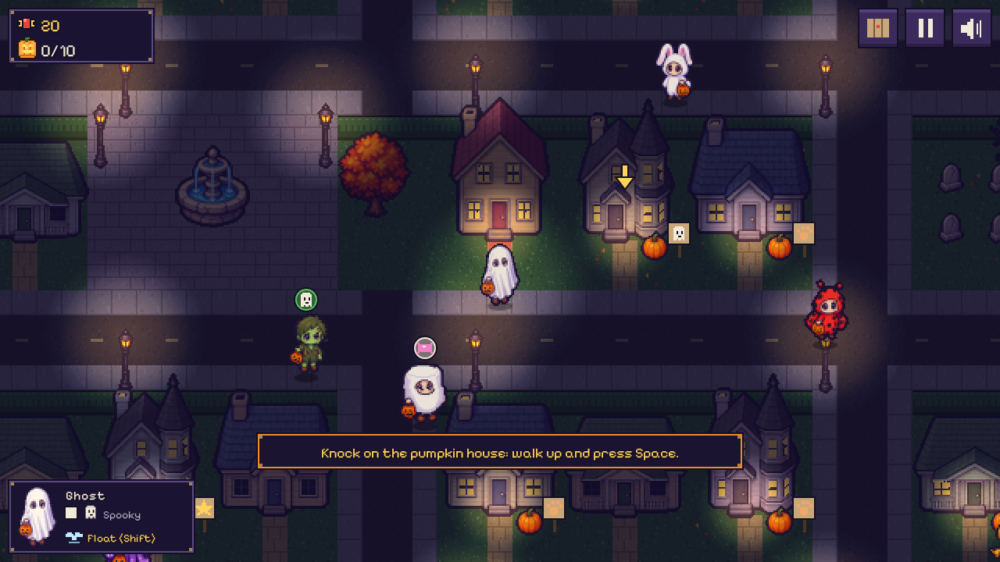 **Your first night.** A friendly arrow walks you through your first knock, your first trade and your first jacks. | 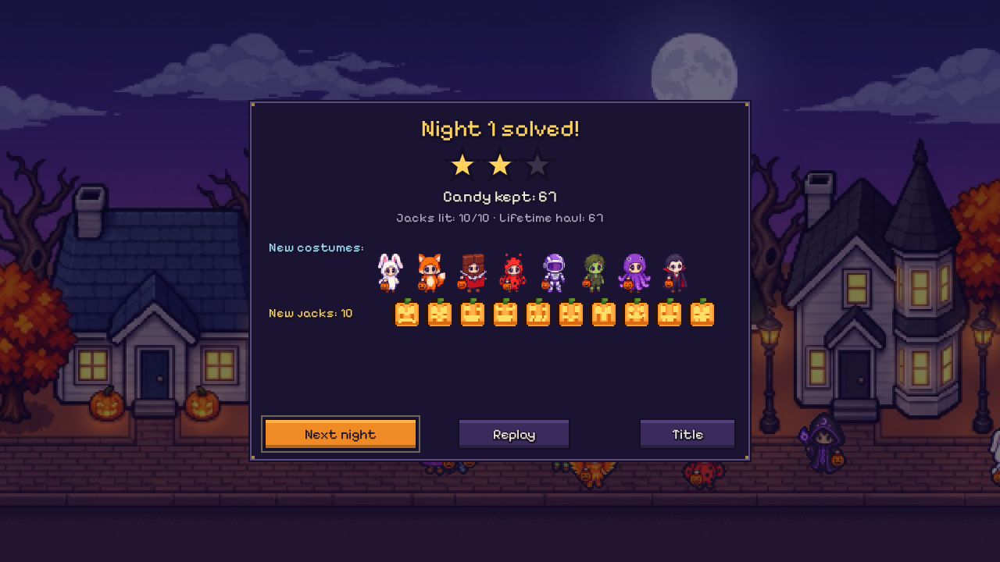 **Night solved!** Count your candy, earn stars, and admire the new costumes and jacks you brought home. |

Eight nights, from *Porch Lights* (light 10 jacks) all the way to *The Big
Night* (all 50). Along the way come fog, candy-snatching pranksters, picky
households that turn their noses up at two kinds of costume, and a
*Midnight Market* where every kid drives a harder bargain. Every night can
always be solved: the right costumes are always somewhere in town, and candy
bowls refill, so you can always earn more.

## Fifty costumes

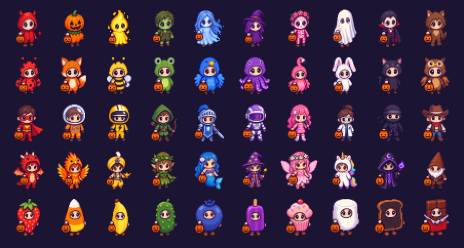

Five kinds (**Spooky**, **Critter**, **Hero**, **Magic** and **Snack**) in ten
colors each, from a Little Devil and a Pumpkinhead to a Flamingo, a Space
Ranger, a Genie and a slice of Burnt Toast. Every costume has a power:

- **Dash** (Heroes): a quick burst of speed.
- **Float** (anything with wings, plus the Ghost and the Witch): sail right
  over hedges, fences and even houses.
- **Boo!** (Spooky): nearby kids freeze, and pranksters run for it.
- **Sniff** (Critters): sniff out the colors nearby houses love, and follow
  the scent to a kid you need.
- **Charm** (Magic): kids wander over to you, and your next trade is half
  price.
- **Sugar Rush** (Snacks): zoom faster and get double candy.

Every costume you trade for stays in your closet for good, and you can change
into any of them at your own front door.

| Your costume closet | Your jack collection |
|---|---|
| 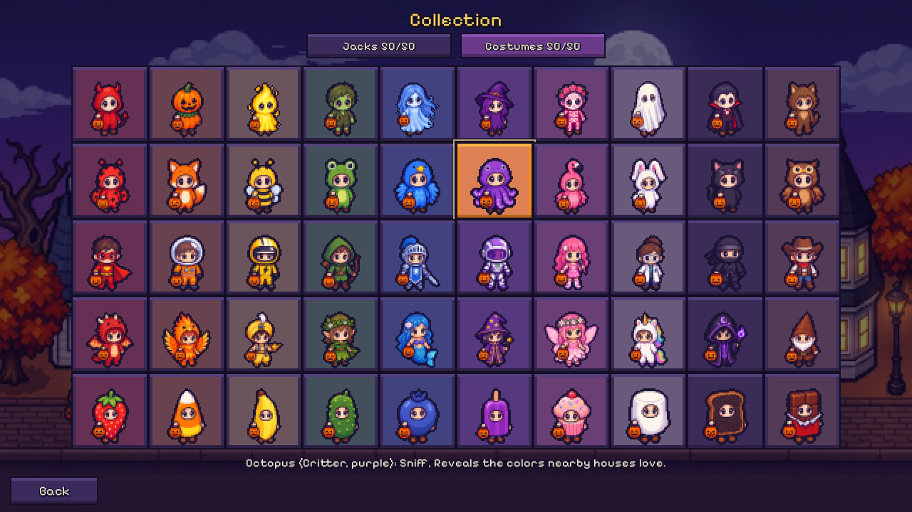 | 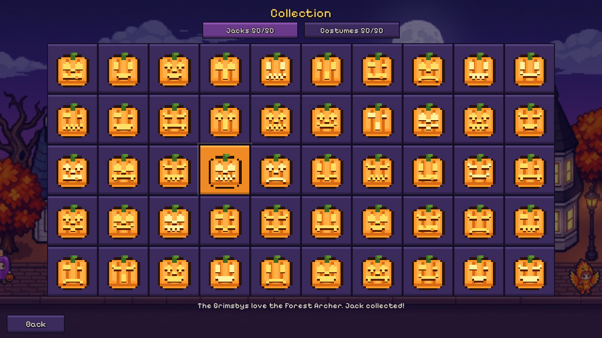 |

Each of the fifty households carves its own jack-o'-lantern face. Once you've
lit a house's jack, it's waiting for you on future nights. Walk up and you can
switch straight into the right costume, so you never have to solve the same
house twice.

## The Big Night

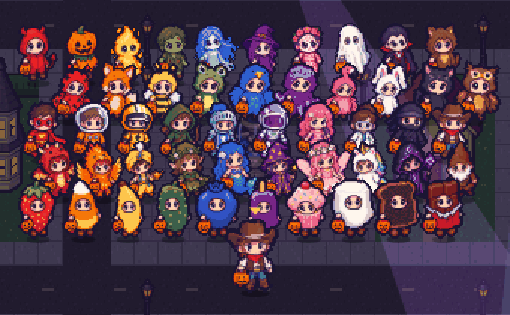

Match every costume to every house and all fifty kids march into the plaza,
line up by kind, and dance with you under the spotlights to a funky spooky
groove. Press Space on the beat for a big group **BOO!** Then everyone shares
the candy haul.

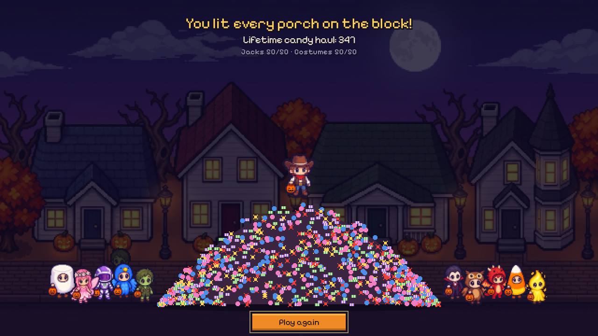

## How to play

- **Move:** arrow keys or WASD.
- **Knock, trade or choose:** Space (or E, or Enter).
- **Costume power:** Shift (or Q).
- **Map:** Tab (or N). **Pause:** Esc or P. **Mute:** M.
- On a phone, drag anywhere on the left side to walk, and tap **A** to knock
  or trade. It works held sideways or upright. You can install it from your
  browser's menu to play full screen, even offline.

The sign on a pumpkin shows the *kind* of costume the house loves. Knock in a
close costume (the same kind or the same color) and they'll tell you the exact
color. Knock in anything else and you'll get three color candidates to narrow
down. There's no losing: your score is the candy you keep, so trade wisely.
Your progress is saved in your browser.

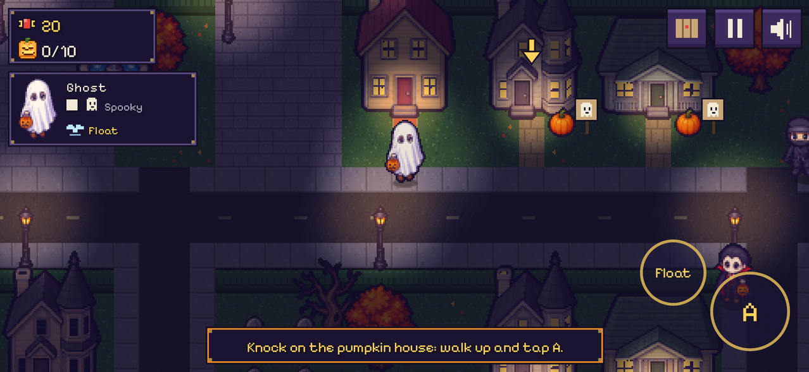

## How it was made

The whole game was made by [Claude Code](https://claude.com/claude-code) with
**[gamegen](https://github.com/zeveck/gamegen)**, a Claude Code plugin that
turns an idea into a finished game. The design, the town generator, the art,
the music, the sound effects and every line of code came from this one command:

> /gg:gamegen I want a game about Halloween in which you select from a small collection of costumes and go trick or treating around a large down, probably pixely, maybe 3/4 overhead view. The town should have dozens of houses. Each house likes a given costume more/less and you get more/better candy the more they like your costume. A bunch of other kids are also trick-or-treating. You can bribe other kids to swap costumes if you have enough candy, and once you gain a costume its in your initial set next time you play. Costumes have powers and some costumes cost more than othes. There should probably be like 50 total costumes, though maybe any given run of the game only includes 20-50 with more as levels get harder. Costumes can repeat a bit, maybe with color swaps in a given run. Not every house has candy every game. The streets should probably layout differently each game. Any house with candy has a pumpkin in the yard, and once you trick-or-treat there with the costume that house likes best, it becomes a jack-o-lantern so you know, and you get that jack-o-lantern in your jack collection. For a given run you can solve it by properly matching up enough houses. In early runs you may only need 10, but as you do better there are more. More houses offer candy on future runs, but you need more jack-o-lanterns to solve that board. it's fundamentally a puzzle game in which you're trying to match the costume to the house while keeping the most candy and there should always be the right costumes on the board to fulfill enough houses and you can always get more candy by re-trick-or-treating a house after a while, so you can always solve a board, but it gets harder as there are more kids and you need more houses. There should be music and effects and some costumes should have fun powers. Once you've gotten a house's jack-o-lantern instead of having a pumpkin it starts with that jack, just not lit yet, and if you go near it it'll let you just switch to the right costume, so you don't have to resolve every house every time if you don't want. In the final run you use every costume and match it to the right house and all the kids dance with you Thriller style and you all share the massive candy haul or something.

After playing it, there was one follow-up request:

> The costumes in the collection look great, but while walking around they all have some blue around the edges. Why? Please fix.

(The game had been adding a moonlit blue rim to every kid so dark costumes
would stand out at night. It looked more like a fringe than moonlight, so it's
gone.)

That's it: no hand-drawn art and no hand-written code. From the first request,
gamegen wrote a design and had a team of reviewer agents (a player, a builder
and an art director) pick it apart. It then generated the art and audio, built
the game, and play-tested it on desktop and phone sizes. A test driver played
whole nights with real key presses, including the 50-house finale. Finally, a
fresh playtester and a bug hunter went over the result. Every town comes from a
generator that checks each night is solvable before you ever see it.

gamegen brings four plugins along. Here's what each one made.

### [imagegen2](https://github.com/zeveck/imagegen2): the trick-or-treaters


imagegen2 creates images with OpenAI's GPT Image. It drew this little ghost
first, and the ghost set the style for everything else: all fifty costumed
kids (drawn ten to a sheet so they'd match), the four kinds of house, the
trees, street lamps, tombstones, fountain and pumpkins, and the app icon.

<br clear="right">

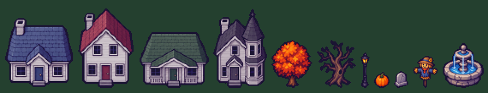

### [nanogen](https://github.com/zeveck/nanogen): the moonlit street

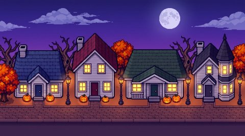

nanogen creates images with Google's Gemini (Nano Banana). Using the houses and
props as references, it painted the moonlit street behind the title screen.
Costumed kids stroll along its sidewalk.

<br clear="right">

### [audiogen](https://github.com/zeveck/audiogen): the sound

audiogen creates audio with ElevenLabs. It composed a spooky harpsichord waltz
for the title, two sneaky pizzicato night themes, and the 116 BPM dance groove
for the finale. It also made every sound in town: door knocks, candy tumbling
into buckets, the
**[whoosh of a jack lighting up](media/showcase/jack-light.mp3)**, ghostly
boos, sniffs, sparkles, crickets and one very
**[rude kazoo](media/showcase/eww.mp3)** for houses that hate your costume.

The ground, the night lighting, the jack-o'-lantern faces, the icons and the
whole finale dance are drawn in code.

## Playing locally

Porchlight is a plain web page with no build step. Serve the `game` folder
with any static web server, for example:

```sh
python3 -m http.server --directory game
```

Then open http://localhost:8000.

## Credits

- Font: [Pixelify Sans](https://github.com/eifetx/Pixelify-Sans), SIL Open
  Font License (`game/fonts/OFL.txt`).
- Code: MIT License (see `LICENSE`).
